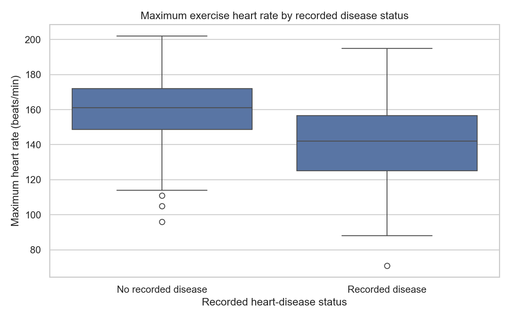
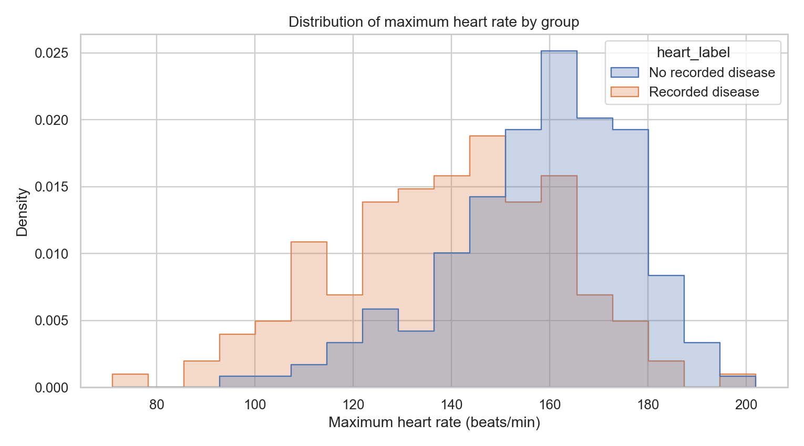
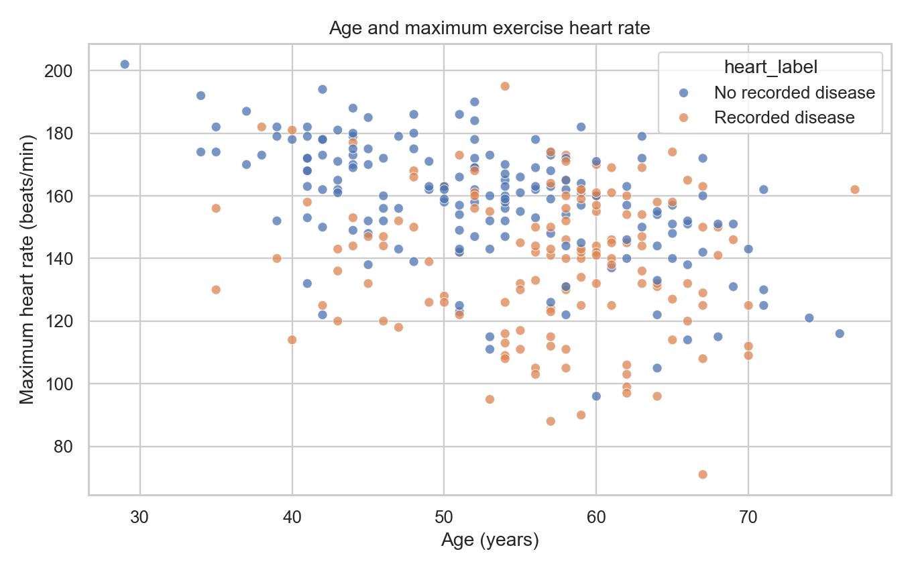
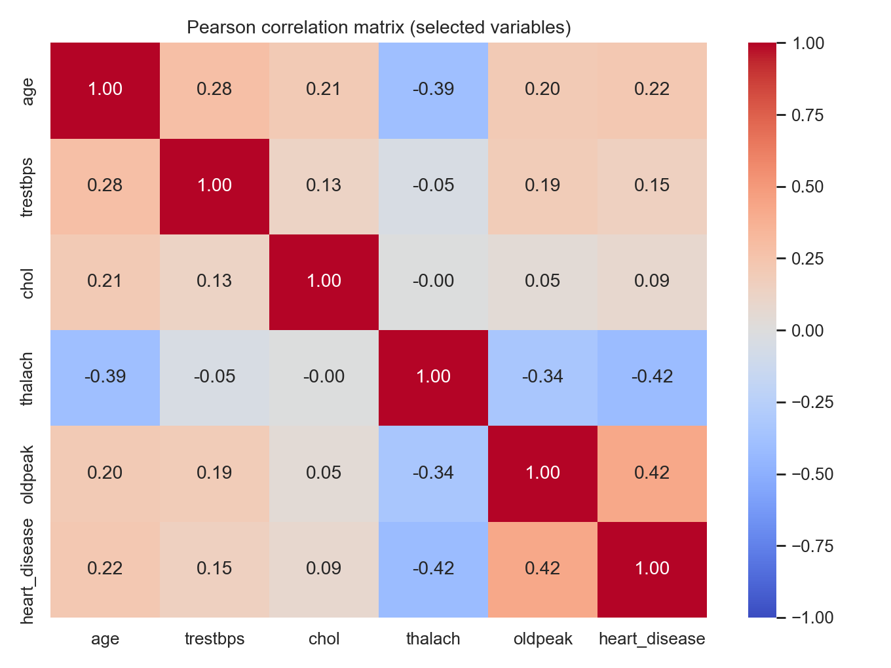
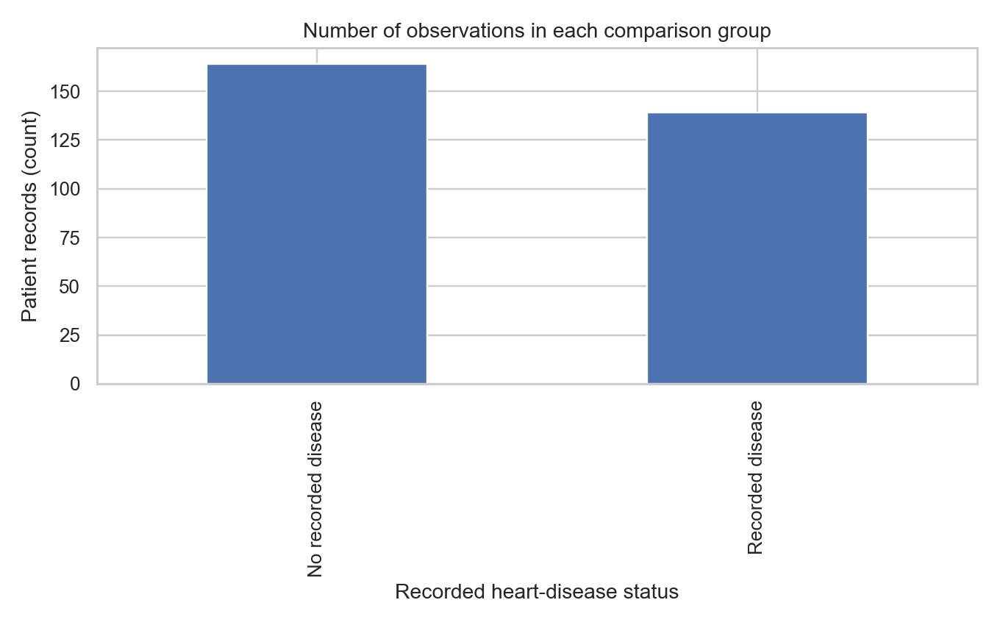
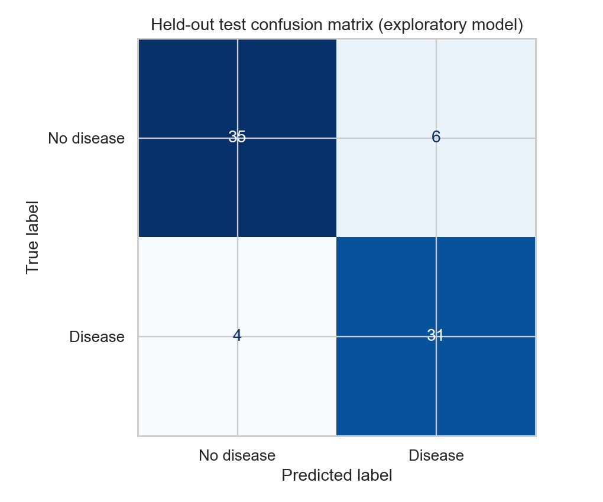

# Cleveland Heart Disease: Maximum Exercise Heart Rate and Recorded Disease Status

**Student:** Ramisha Tasfia  
**Research question:** How does maximum exercise heart rate differ between patients with and without recorded heart disease?

## Executive summary
Among 303 Cleveland clinical records, mean maximum exercise heart rate was **158.38 bpm** in the no-recorded-disease group (n=164) and **139.26 bpm** in the recorded-disease group (n=139). The unadjusted mean difference was **19.12 bpm** (95% CI **14.33–23.91**). Welch’s two-sided t-test: **t≈7.858**, **p≈9.11×10⁻¹⁴**; Cohen’s d≈0.918. This is an association, not evidence of causation or an individual diagnosis.

## Dataset and attribution
UCI Machine Learning Repository, *Heart Disease*, processed Cleveland subset; original contributors Andras Janosi, William Steinbrunn, Matthias Pfisterer, Robert Detrano. DOI: https://doi.org/10.24432/C52P4X. License: CC BY 4.0. This analysis CSV adds column headers and represents original `?` values as missing.

## Data cleaning log
- Started with 303 rows and 14 columns.
- Found six missing cells: four in `ca` and two in `thal`.
- Found zero exact duplicate rows.
- Checked numeric conversions, categories, and plausible ranges.
- Flagged one `thalach` outlier using 1.5×IQR; retained it because unusual does not imply erroneous.
- Retained all 303 rows for the primary comparison because missing values are in unrelated fields.
- For the optional model, imputed missing predictors using training-set statistics only.

## Visualizations and findings

**Figure 1 — Boxplots:** The no-disease group has a higher central maximum heart rate, but values overlap.

**Figure 2 — Distributions:** Both groups have broad, overlapping distributions; the no-disease distribution is shifted higher.

**Figure 3 — Age and heart rate:** Age is a potential confounder of the unadjusted association.

**Figure 4 — Correlations:** Pairwise linear associations are descriptive and do not prove causation.

**Figure 5 — Group counts:** 164 no-recorded-disease and 139 recorded-disease records.

## Statistical method and interpretation
H₀: the two population mean maximum exercise heart rates are equal; H₁: they differ. A two-sided Welch independent-samples t-test was used at α=.05 because it does not assume equal variances. The 95% confidence interval for the unadjusted mean difference is 14.33–23.91 bpm. A Mann–Whitney U sensitivity analysis appears in the notebook; it tests a rank/distribution comparison, not the same mean-difference estimand. Independent records are assumed but not verifiable from the CSV.

## Optional classification exercise
The notebook includes a stratified held-out logistic-regression evaluation, with training-only preprocessing and a majority-class baseline. The executed run reported about 86.8% accuracy, 83.8% precision, 88.6% recall and 53.9% baseline accuracy. This is **not** a clinically validated diagnostic tool.

## Limitations and ethics
This small historical Cleveland clinical sample is not representative of the US population. Binary disease status combines original severity codes 1–4; age, fitness, medication, and other factors may confound comparisons. No causal or diagnostic claim is justified. Data are attributed under CC BY 4.0.

## Conclusion
Maximum exercise heart rate was lower on average among records with recorded heart disease by approximately 19 bpm. The observed unadjusted group difference was statistically significant, but the distributions overlap and further adjusted and externally validated research is necessary for broader conclusions.

## How to reproduce
1. Keep `Cleveland_Heart_Disease_FINAL.ipynb`, `data/cleveland_heart_disease.csv`, `requirements.txt`, and `charts/` in the same repository.
2. Install dependencies: `pip install -r requirements.txt`.
3. Open the notebook in Jupyter or VS Code and select **Restart & Run All**.
4. Compare the generated charts and statistics with the report.

## AI-use disclosure and required submission items
AI assistance was used in notebook/code structuring and report drafting. **Ramisha Tasfia must verify and personalize this disclosure, retain the accurate prompt log, and review all results.** Include the executed notebook PDF, public repository URL, and student-produced 3–5-minute walkthrough according to the assignment instructions.
